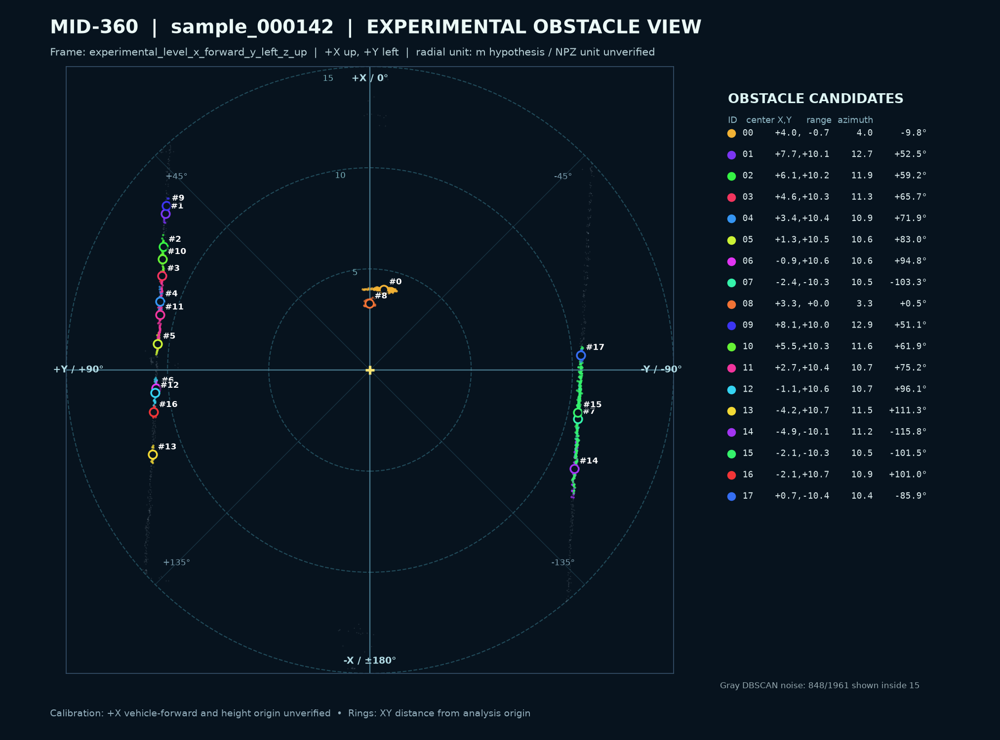
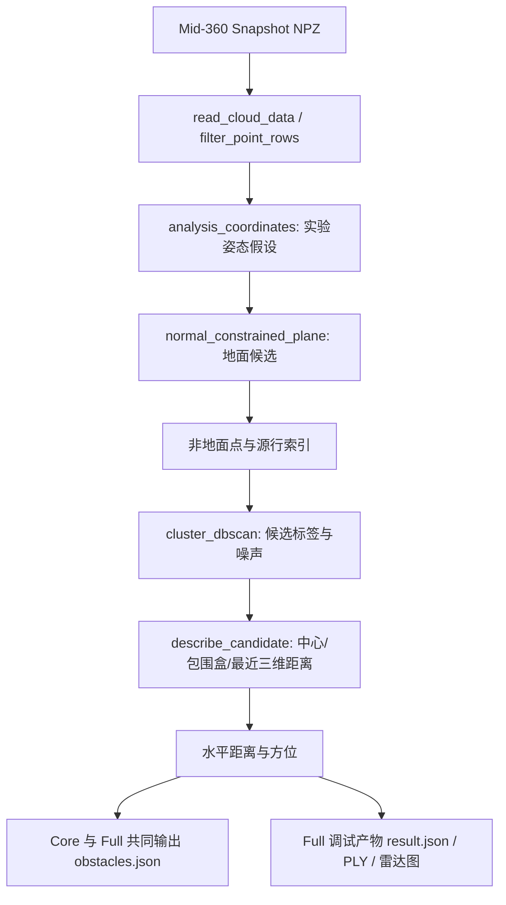

# Mower LiDAR Obstacle Perception（智能割草机激光雷达障碍物感知模块）

基于 Livox Mid-360 三维点云的 **Python 离线障碍候选提取原型**。面向机场草地等割草机场景，输出空间候选的坐标、最近点距离、尺寸、方位和二维雷达图。模块只负责感知实验；停车控制、路径规划和自动驾驶决策不在本项目中。当前结果尚未经过正式外参和检出性能验收，不能作为车辆安全功能使用。



图中是 **DBSCAN 候选簇的 XY 投影**，不是原始雷达回波或人工真值。图上 `EXPERIMENTAL`、单位与坐标方向说明必须随图保留。

## 已实现功能与主流程

- 读取含 `points`/`fields` 的 NPZ，按字段名提取 XYZ、intensity；过滤非有限值，并按默认配置排除 XYZ 全零行，保留源行索引。
- 按显式配置做**实验性**姿态旋转与高度平移；保留原始雷达坐标用于最近三维距离。
- 法向和截距约束的多次 RANSAC 寻找地面候选；被拒绝的大平面留在非地面区域，避免直接删除可能的墙面。
- Open3D DBSCAN 对非地面点聚类；保留灰色未聚类点和完整非地面点云。
- 输出候选中心、轴对齐三维包围盒、相对原始雷达原点最近三维距离、实验坐标系 XY 水平距离和方位角。
- 导出 JSON、彩色 PLY、二维 PNG 雷达图。历史 Patchwork++、简单高度基线和欧式聚类仍可通过 `offline_detector.py` 的其他配置用于对照，**不属于默认主流程**。



## 项目结构

```text
mower-lidar/
├─ scripts/
│  ├─ run_perception.py             # 正式离线调用入口，串联已有模块
│  ├─ offline_detector.py           # 配置驱动的清理、姿态、地面、聚类与 JSON/PLY
│  ├─ radar_view.py                 # 二维方位字段与静态雷达图
│  ├─ npz_to_ply.py                 # 共享 NPZ 读取器；main 为历史转换示例
│  ├─ prepare_cloud.py              # R1 清理规则及独立清理工具
│  ├─ convert_field_rosbag.py       # 已验收现场 PointCloud2 DB3 → NPZ
│  ├─ check_release_smoke.py        # 用合成点云验证 Core / Full 入口
│  ├─ benchmark_perception.py      # R3.8 本地性能基准
│  ├─ extract_obstacle_candidates.py# RANSAC、DBSCAN、候选几何、PLY 共用函数
│  ├─ patchwork_ground.py           # 历史 Patchwork++ 对照实现
│  ├─ check_*.py                    # 离线结果/几何自检
│  └─ run_r3_*.py 等                # 历史批量实验和辅助脚本
├─ configs/
│  ├─ field_66cm_7p5deg_ransac_dbscan.json # 现场配置，通过 --config 显式选择
│  └─ r3_2_ransac_normal_trial.json        # 历史配置，兼容默认值
├─ docs/                            # 接口、参数调优、运行说明和验证报告
├─ data/                            # 本地数据目录，不进入 Git
├─ outputs/                         # 本地生成结果，不进入 Git
├─ environment.yml                  # Python 3.11 Conda 基础环境声明
└─ requirements.txt                 # 已有环境的 pip 版本快照
```

各函数及实验脚本的界限见 [架构文档](docs/PROJECT_ARCHITECTURE.md)。历史报告链接到 `outputs/` 的图片只适用于保留了本地实验结果的工作站；GitHub 克隆不含这些大批量输出。

## 环境与快速开始（Windows PowerShell）

已验证环境为 Windows Python 3.11.17、NumPy 1.26.4、Open3D 0.19.0、SciPy 1.17.1、Matplotlib 3.11.2、pypatchworkpp 1.4.1 和 Pillow 12.3.0。离线检测在 CPU 上运行。Open3D 提供正式 DBSCAN 实现，pypatchworkpp 仍是现有检测模块的导入依赖。`requirements.txt` 固定本地验证环境的 pip 版本，也包含历史工具的依赖。新建环境需由使用者执行下列命令。已有环境直接激活即可。

```powershell
git clone https://github.com/LiKangzhi12138/mower-lidar.git
Set-Location mower-lidar
conda env create -f environment.yml
conda activate mower-lidar
python -m pip install -r requirements.txt
python -m pip check
```

从仓库根目录运行。把自己的 NPZ 放到 `data/field/message_000092.npz`，或把 `$npz` 设为实际文件路径。以下两条现场命令显式加载 **0.66 m / +7.5°** 配置。每次使用新的或空输出目录。

```powershell
conda activate mower-lidar
$npz = 'data/field/message_000092.npz'
$cfg = 'configs/field_66cm_7p5deg_ransac_dbscan.json'
python -B scripts/run_perception.py --input $npz --config $cfg --mode core --output-dir outputs/field_core
python -B scripts/run_perception.py --input $npz --config $cfg --mode full --output-dir outputs/field_full
```

省略 `--config` 会加载 **0.415 m / +5°** 的历史 R3.2 配置。现场使用时应显式传入与硬件相符的配置。[现场配置](configs/field_66cm_7p5deg_ransac_dbscan.json) · [历史配置](configs/r3_2_ransac_normal_trial.json)

## 输入与接口

NPZ 推荐包含 `points`，形状 N×4，类型 float32，四列依次表示原始雷达坐标的 x、y、z 和 intensity。另存 `fields=np.array(["x", "y", "z", "intensity"])`。保留原始点序与单位，姿态变换由检测器按配置执行。ROS 2 DB3 转换器可读取 R3.9 已验收的三个现场包和对应 PointCloud2 CDR 布局，分别保存点和时间戳。它对未知布局报错，参数可用 `python -B scripts/convert_field_rosbag.py --help` 查阅。[转换说明](docs/R3_FIELD_MERGING_DIAGNOSTIC.md)

`obstacles.json` 顶层的 `candidate_count`、`unclustered_point_count` 和 `candidates` 分别记录簇数、未聚类点数和候选列表。`coordinate_parameters`、`ground_parameters`、`clustering_parameters` 记录生效配置。逐簇常用字段如下。

| 实际字段 | 含义 |
| --- | --- |
| `id` / `obstacle_id`、`point_count`、`input_indices` | 当前帧簇标签、点数、原始 NPZ 行号 |
| `center_xyz`、`bbox_min_xyz`、`bbox_max_xyz`、`bbox_extent_xyz` | 分析坐标中的中心、轴对齐包围盒及三轴尺寸 |
| `nearest_sensor_xyz`、`nearest_sensor_distance` | 原始雷达原点参考的最近点与三维距离 |
| `range_xy`、`nearest_range_xy`、`azimuth_deg` | 分析坐标中的中心水平距离、最近水平距离和中心方位角 |

方位角以实验分析坐标 +X 为 0°，+Y 为 +90°。该坐标使用 +Y 轴姿态旋转和 +Z 高度平移。现场雷达轴向及高度测量参考点仍需外参核实，输出的 `coordinate_unit_confirmed` 仍为 `false`。[完整输入输出协议与 JSON 示例](docs/INPUT_OUTPUT_SPEC.md)

## full 与 core 模式（R3.8）

省略 `--mode` 默认执行 `full`。Core 和 Full 使用相同的检测及候选几何。Core 每帧只写一个 `obstacles.json`。Full 另外输出 `obstacles_colored.ply`、`radar_view.png` 及非空地面/非地面 PLY，`detection/` 记录原始计算结果、索引和逐簇点云。

`core` 的坐标、最近三维距离、包围盒、水平距离和方位角定义与 `full` 相同；未生成的 `point_cloud`、`source_result_json`、`radar_plot` 和 PNG/PLY 输出引用为 `null`。地面诊断沿用检测器已有字段，不引入 `ground_status`。独立 `radar_view.py --result-json ...` 接口保持可用。性能口径和真实测量见 [R3.8 性能报告](docs/R3_PERFORMANCE_BENCHMARK.md)。

## 检测效果不好时如何调整参数

| 现场参数路径 | 基准 | 首要影响 |
| --- | ---: | --- |
| `clustering.params.eps` | 0.35 | 邻域半径，影响合并、拆分与噪声 |
| `clustering.params.min_points` | 12 | 核心点邻域点数，影响稀疏目标与连接 |
| `coordinates.mount_height` | 0.66 m 安装假设 | 改变地面竖直截距 |
| `coordinates.mount_pitch_degrees` | +7.5° | 改变地面法向与分析坐标 |

先检查地面过滤，再根据同一帧的连接与噪声情况调聚类。每次复制配置并改一项，通过 `--config` 显式加载。参数单位、调参流程、十类故障处置与实操命令见 [Mid-360 障碍检测参数配置与效果调优指南](docs/PARAMETER_TUNING_GUIDE.md)。

## 测试

克隆仓库后，即使没有现场数据也能运行以下测试。它生成合成 NPZ，通过正式 CLI 核对两种模式的几何和产物。

```powershell
python -B scripts/check_release_smoke.py --output-dir outputs/release_smoke
```

已有本地录包和历史产物时，可按需运行现场回归、R3.4 雷达图检查及性能工具。公开克隆不含历史点云和运行产物。[运行及测试](docs/RUNNING_AND_TESTING.md)

## 可视化与方位约定

用 CloudCompare 分别打开 `ground.ply`（绿色**地面候选**）、`nonground.ply`（完整非地面候选）和 `obstacles_colored.ply`（不同颜色的簇；灰色为未聚类点）；不要仅看彩色簇而忽略灰色点。`radar_view.png` 中原点位于中央、实验坐标 **+X 向上、+Y 向左**，方位角 `atan2(y,x)`：+X 为 0°，+Y 为 +90°，−Y 为 −90°。同心圆与 XY 轴等比例，标注的距离是**当前坐标数值的水平距离**，不能直接宣称已验收的米制车辆距离。图层和人工检查方式见 [运行文档](docs/RUNNING_AND_TESTING.md)。

## 进度与限制

R3.8 验证 Core 与 Full 几何一致，R3.9 验证现场 DB3 转换和聚类诊断，R3.10 完成 111 条现场消息的 Core 通过性与几何回归。[现场回归报告](docs/R3_FIELD_CONFIG_VALIDATION.md)

R0 审查数据，R1 清理输入，R2/R2.5 验证平面与聚类候选，R3 建立离线检测器，R3.2 用 142 对比地面方法，R3.3 在 143～149 多场景运行，R3.4 增加二维方位与雷达图。现选择法向约束 RANSAC + DBSCAN 作为**开发主路线**。详情见 [项目状态](docs/PROJECT_STATUS.md)及各阶段原始报告。

目前主要完成离线运行和有限人工观察：尚未正式核实 NPZ 保存链是否完整保持米制；0.415 m 是否从雷达内部原点测量、雷达 +X 与真实车头关系和 143～149 安装一致性仍待确认。未获得充分地面/障碍真值，不能给出准确率、召回率、实际距离与方位精度。没有 ROS 2 在线节点、Jetson 部署或端到端实时延迟测试；离线算法计时不能代表实机实时性。完整限制见 [算法文档](docs/ALGORITHM.md)。

本仓库尚未附开源许可证；使用与再分发条件需由项目所有者决定。

## Jetson / ROS 2 接入

部署人员需要接入实际点云，记录和对齐消息时间、点序、坐标系和外参，选择现场验证过的配置，并按 `obstacles.json` 的坐标与单位语义适配接口。先用录包回放对比同一帧的预处理、地面候选和聚类，再测在线吞吐量、延迟和丢帧。Jetson 平台的 Python wheel、ROS 2 适配和实际实时性能需单独验证。[部署与调优说明](docs/PARAMETER_TUNING_GUIDE.md#10-现场部署)
