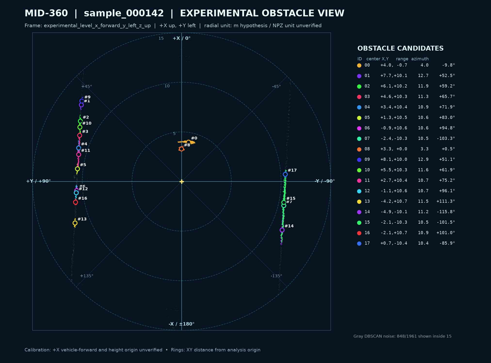
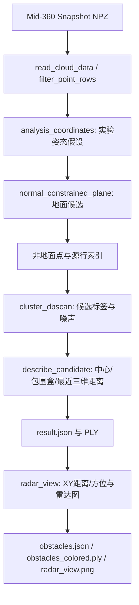

# Mower LiDAR Obstacle Perception（智能割草机激光雷达障碍物感知模块）

基于 Livox Mid-360 三维点云的 **Python 离线障碍候选提取原型**。面向机场草地等割草机场景，输出空间候选的坐标、最近点距离、尺寸、方位和二维雷达图。模块只负责感知实验；停车控制、路径规划和自动驾驶决策不在本项目中。当前结果尚未经过正式外参和检出性能验收，不能作为车辆安全功能使用。



图中是 **DBSCAN 候选簇的 XY 投影**，不是原始雷达回波或人工真值。图上 `EXPERIMENTAL`、单位与坐标方向说明必须随图保留。

## 已实现功能与主流程

- 读取含 `points`/`fields` 的 NPZ，按字段名提取 XYZ、intensity；过滤非有限值，并按默认配置排除 XYZ 全零行，保留源行索引。
- 按显式配置做**实验性**姿态旋转与高度平移；保留原始雷达坐标用于最近三维距离。
- 法向和截距约束的多次 RANSAC 寻找地面候选；被拒绝的大平面留在非地面区域，避免直接删除可能的墙面。
- Open3D DBSCAN 对非地面点聚类；保留灰色未聚类点和完整非地面点云。
- 输出候选中心、轴对齐三维包围盒、相对原始雷达原点最近三维距离、实验坐标系 XY 水平距离和方位角。
- 导出 JSON、彩色 PLY、二维 PNG 雷达图。历史 Patchwork++、简单高度基线和欧式聚类仍可通过 `offline_detector.py` 的其他配置用于对照，**不属于默认主流程**。



## 项目结构

```text
mower-lidar/
├─ scripts/
│  ├─ run_perception.py             # 正式离线调用入口，串联已有模块
│  ├─ offline_detector.py           # 配置驱动的清理、姿态、地面、聚类与 JSON/PLY
│  ├─ radar_view.py                 # 二维方位字段与静态雷达图
│  ├─ npz_to_ply.py                 # 共享 NPZ 读取器；main 为历史转换示例
│  ├─ prepare_cloud.py              # R1 清理规则及独立清理工具
│  ├─ extract_obstacle_candidates.py# RANSAC、DBSCAN、候选几何、PLY 共用函数
│  ├─ patchwork_ground.py           # 历史 Patchwork++ 对照实现
│  ├─ check_*.py                    # 离线结果/几何自检
│  └─ run_r3_*.py 等                # 历史批量实验和辅助脚本
├─ configs/                         # JSON 参数；主流程采用 r3_2_ransac_normal_trial.json
├─ docs/                            # 接口、算法、运行说明和 R0～R3.4 历史报告
├─ data/                            # 本地数据目录，不进入 Git
├─ outputs/                         # 本地生成结果，不进入 Git
├─ environment.yml                  # Python 3.11 Conda 基础环境声明
└─ requirements.txt                 # 已有环境的 pip 版本快照
```

各函数及实验脚本的界限见 [架构文档](docs/PROJECT_ARCHITECTURE.md)。历史报告链接到 `outputs/` 的图片只适用于保留了本地实验结果的工作站；GitHub 克隆不含这些大批量输出。

## 环境与快速开始（Windows PowerShell）

现有测试环境：**Python 3.11.17、NumPy 1.26.4、Open3D 0.19.0、SciPy 1.17.1、scikit-learn 1.9.1、Matplotlib 3.11.2、pypatchworkpp 1.4.1、Pillow 12.3.0**。这是实际环境版本记录，不代表其他版本已测试。离线运行无需 GPU；未进行 Jetson 或 ROS 2 验证。已有环境可 `conda activate mower-lidar`。需要自行配置新环境时，可参考以下命令；本轮**没有执行环境创建或安装**，完整 pip 快照可能含有主流程不需要的历史工具包：

```powershell
conda env create -f environment.yml
conda activate mower-lidar
python -m pip install -r requirements.txt
```

```powershell
cd E:\workspace\mower-lidar
conda activate mower-lidar
$npz = 'E:\workspace\mower-data\data\newdata\sample_000142\lidar\cloud_01.npz'
python -B scripts/run_perception.py --input $npz --output-dir outputs/quickstart_sample_000142
```

这是已用 `sample_000142` 实际验证的命令。输出目录需为空或尚不存在；再次运行请选新的目录，防止覆盖已有实验。`--config` 可指定兼容主路线的 JSON，省略时使用 [固定 R3.2 主配置](configs/r3_2_ransac_normal_trial.json)。GitHub 用户需自行提供符合下述协议的 NPZ；示例中的 `E:\workspace\mower-data` **仅是本机测试数据位置**，程序不依赖这个路径。命令必须从项目根目录运行。

结果主要在 `outputs/quickstart_sample_000142/`：`obstacles.json`、`obstacles_colored.ply`、`radar_view.png`、`ground.ply`、`nonground.ply`；`detection/result.json`、`detection/indices_and_labels.npz` 与逐簇 PLY 保存原检测细节。`result.json` 保持 R3 原字段语义，`obstacles.json` 在候选条目上增加 XY 距离/方位。详见 [输入输出协议](docs/INPUT_OUTPUT_SPEC.md) 和 [运行及测试](docs/RUNNING_AND_TESTING.md)。

## 可视化与方位约定

用 CloudCompare 分别打开 `ground.ply`（绿色**地面候选**）、`nonground.ply`（完整非地面候选）和 `obstacles_colored.ply`（不同颜色的簇；灰色为未聚类点）；不要仅看彩色簇而忽略灰色点。`radar_view.png` 中原点位于中央、实验坐标 **+X 向上、+Y 向左**，方位角 `atan2(y,x)`：+X 为 0°，+Y 为 +90°，−Y 为 −90°。同心圆与 XY 轴等比例，标注的距离是**当前坐标数值的水平距离**，不能直接宣称已验收的米制车辆距离。图层和人工检查方式见 [运行文档](docs/RUNNING_AND_TESTING.md)。

## 进度与限制

R0 审查数据，R1 清理输入，R2/R2.5 验证平面与聚类候选，R3 建立离线检测器，R3.2 用 142 对比地面方法，R3.3 在 143～149 多场景运行，R3.4 增加二维方位与雷达图。现选择法向约束 RANSAC + DBSCAN 作为**开发主路线**。详情见 [项目状态](docs/PROJECT_STATUS.md)及各阶段原始报告。

目前主要完成离线运行和有限人工观察：尚未正式核实 NPZ 保存链是否完整保持米制；0.415 m 是否从雷达内部原点测量、雷达 +X 与真实车头关系和 143～149 安装一致性仍待确认。未获得充分地面/障碍真值，不能给出准确率、召回率、实际距离与方位精度。没有 ROS 2 在线节点、Jetson 部署或端到端实时延迟测试；离线算法计时不能代表实机实时性。完整限制见 [算法文档](docs/ALGORITHM.md)。

本仓库尚未附开源许可证；使用与再分发条件需由项目所有者决定。
